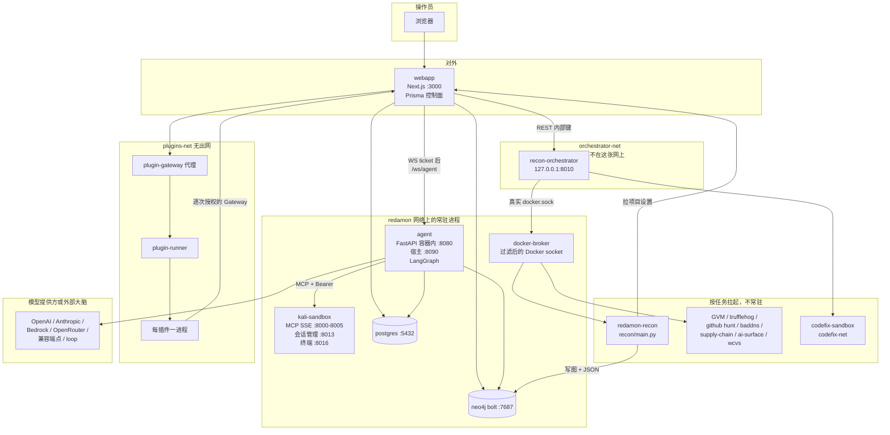
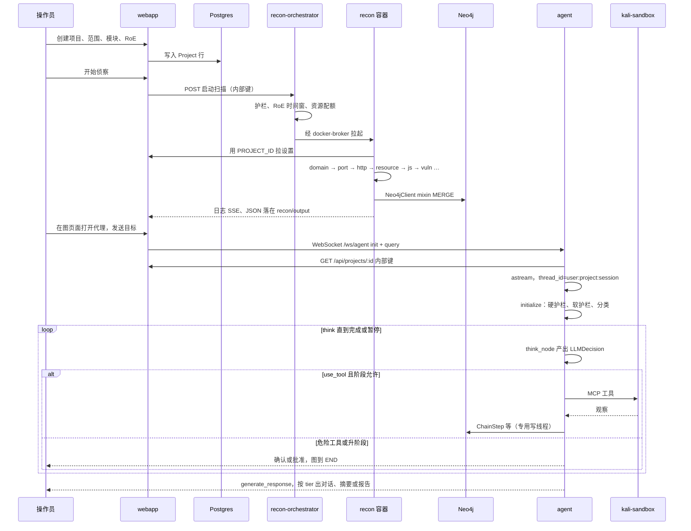
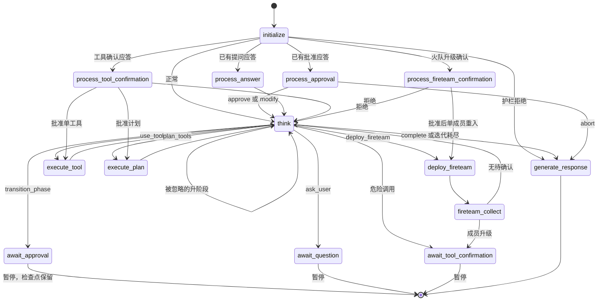
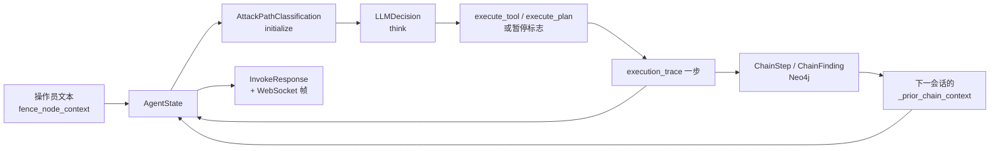

# RedAmon 代码架构与实现分析

> 静态阅读记录。对象是本检出 `Silver-cybersec/redamon`，`VERSION` 为 **7.7.0**，分析时 `master` 头为 `046921e6`。只读源码与仓库内文档，没有运行服务、没有安装依赖、没有构建或拉取镜像、没有对任何目标发请求。
>
> 代码标识符、文件路径、配置键、节点名保持原文。文中的「工具」「阶段」「沙箱」都是在描述这套软件怎么组织，不是操作手册。
>
> 仓库根目录没有 `SECURITY_AUDIT.md`。安全策略在 `SECURITY.md`，安全姿态说明在 `docs/readmes/README.SECURITY_POSTURE.md`。更早的代理白皮书是 `docs/readmes/README.AGENTIC_SYSTEM.md`（文首标 **Version 4.13.0 / 2026-05-27**）。那份白皮书的叙事仍然有用，但节点名和节点个数已经和当前 `agentic/orchestrator.py` 不完全一致，下面以源码为准，并在第 10 节列出差异。

---

## 1. 一句话定位与适用场景

RedAmon 是一套**自托管的授权安全测试平台**：先用确定性侦察流水线把攻击面写进 Neo4j，再由 LangGraph 上的阶段化 ReAct 代理在 Kali MCP 沙箱里验证，关键动作必须等人批准，最后由 CypherFix 把发现整理成可审查的修复。

它适合这些场景：

- 你拥有或已获书面授权的目标，想把「侦察 → 验证 → 分诊 → 修代码」放在同一套可审计的系统里。
- 需要多租户隔离、交战规则（Rules of Engagement）、阶段门和操作员实时刹车，而不是一个无状态的「模型加 shell」。
- 想把扫描结果沉淀成图，让下一次会话从已有攻击面和攻击链记忆开始，而不是每次从零重新发现。

它不适合这些用法：

- 对未授权系统做扫描或利用。仓库的 `README.md` 与 `DISCLAIMER.md` 把这一点写成使用前提。
- 把代理当成可以看见目标源码的白盒助手。`agentic/AGENTS.md` 规定代理按黑盒工作，提示词、技能和工具不得假设目标内部实现。
- 把第三方插件逻辑写进本仓库。插件目录 `redamon-plugins/` 若存在，是另一个 git 仓库，本仓库只提供宿主平台。

对外一句话（`README.md`）：开源、自托管的 AI 渗透测试框架，把攻击面画成图，在 Kali 沙箱里经人工批准做验证，并为发现打开修复用的 pull request。

---

## 2. 核心理念与设计取舍

### 2.1 一句话理念

**非确定性只允许发生在「想」这一步；何时跑工具、何时停下等人、记住什么、写到哪张图，全部由确定性外壳决定。**

这个外壳有四层：

1. **侦察是流水线，不是代理的第一轮工具调用。** `recon/main.py` 按模块顺序（可跳过、可部分重跑）产出 JSON，并用 `graph_db.Neo4jClient` 写入图。代理开始时用 `query_graph` 读已经存在的攻击面。
2. **代理是一张显式状态机，不是 `while` 循环。** `AgentOrchestrator._build_graph` 用 LangGraph `StateGraph(AgentState)` 编译。每条边都有名字，路由函数只读已经解析好的 `LLMDecision`。
3. **人在环是一等状态，不是回调补丁。** 阶段跃迁、向操作员提问、危险工具确认，都会把图跑到 `END` 并留下挂起标志。下一次 WebSocket 消息用同一个 `thread_id` 再进入 `initialize`，由挂起标志分流到对应的 `process_*` 节点。源码里没有 `langgraph` 的 `interrupt()`。
4. **记忆分三处，职责不混。** 会话工作记忆在 `AgentState`（检查点在 Postgres）；攻击链在 Neo4j 的 EvoGraph（`AttackChain` / `ChainStep` / `ChainFinding` / `ChainDecision` / `ChainFailure`）；对话文本在 Prisma 的 `Conversation` / `ChatMessage`。租户边界是每个业务节点唯一键末尾的 `user_id` + `project_id`（`graph_db/schema_keys.py`）。

仓库把这套代理模式叫做 **Scatter-Gather ReAct（SG-ReAct）**。根代理自己跑 ReAct；当目标能拆成互不依赖的调查角度时，它发出 `deploy_fireteam`，若干专家成员在同一个 asyncio 事件循环里各跑一张更小的子图，再由 `fireteam_collect` 把结果折回父状态。成员不能再部署 fireteam，也不能自己升阶段。

### 2.2 和三种常见形态的异同

| 形态 | 它通常怎么做 | RedAmon 相同的地方 | RedAmon 不同的地方 |
| --- | --- | --- | --- |
| 经典 ReAct | 单循环：想 → 一个工具 → 观察 → 再想 | `think` 仍是枢纽；`action=use_tool` 进 `execute_tool`，执行完回到 `think` | 还有 `plan_tools`（一轮里多个互不依赖的工具）和 `deploy_fireteam`（多个有自己预算的子代理）。分析不单独占一个图节点，合并进下一次 `think` |
| Planner-Executor | 先出完整计划，执行器只负责跑 | `plan_tools` 和 Deep Think 的 `priority_order` 都是计划 | 计划不是开局一次性产物。Deep Think 只在阶段切换、生产力分数跨档、模型自己求助等时刻插入 `think_node` 内部，而且受冷却和 Jaccard 新颖性检查约束。执行器仍会因为阶段、RoE、确认门拒绝计划里的某一步 |
| Multi-agent mesh | 多个代理对等对话，用消息总线协调 | 有多个同时推理的成员，结果写回同一条攻击链 | 只有根代理决定何时散开、每个成员的任务和工具清单。没有成员之间的总线。成员子图不挂检查点，父状态才持久化。危险调用仍走操作员确认 |

相对「一个 Planner 写死计划、一个 Executor 盲跑」，这里的计划随时可以被下一次 `think` 推翻。相对「一群代理互相聊天」，扇出是有界的：`FIRETEAM_MAX_CONCURRENT`、`FIRETEAM_MAX_MEMBERS`、`FIRETEAM_TIMEOUT_SEC`、每成员 `FIRETEAM_MEMBER_MAX_ITERATIONS`，并且 `PERSISTENT_CHECKPOINTER` 为真才允许部署（`think_node` 在动作到达路由器之前就做这道门）。

### 2.3 刻意接受的取舍

- **LangGraph 的状态模式很严。** `AgentState` 是 `TypedDict`。节点返回里没有声明的字段会被框架丢掉。代价是加一个记忆字段必须改 `state.py`，好处是「值从哪进记忆」可以审计。
- **检查点换来可恢复，也换来状态膨胀。** 默认字典 `DEFAULT_AGENT_SETTINGS['PERSISTENT_CHECKPOINTER']` 为 `True`。`AgentOrchestrator._setup_checkpointer` 在进程启动、尚未加载任何项目时读这个默认值；为真且存在 `DATABASE_URL` 时换成 `AsyncPostgresSaver`，失败则退回 `MemorySaver`。`docker-compose.yml` 里的同名环境变量**没有**被 Python 读取（全仓库没有 `os.environ` 读取 `PERSISTENT_CHECKPOINTER`）。真正生效的是设置字典里的默认值 `True`。
- **黑盒优先于「更聪明」。** 技能文本可以描述攻击类别的方法，但不能把某个目标的源码、内部路由或凭据写进提示词。CypherFix 的 CodeFix 是这条规则的例外：它克隆的是**客户自己的修复仓库**，在 `codefix-net` 里改代码，不把仓库内容交回进攻代理。
- **失败关闭，而不是失败放行。** 项目设置拉不到（`SETTINGS_SOURCE_KEY == "default"`）时，`initialize_node._scope_gate` 直接拒绝本轮。硬护栏或软护栏出错同样拒绝。LLM 护栏解析失败不会当成「允许」。
- **插件不能成为第四个大脑。** 已批准的技能文本覆盖以数据形式放进项目设置，由 `prompts/skill_part_seam.py` 在渲染时替换。代理进程不调用插件代码。插件动作要经 Gateway 逐次授权，而且只能提议。
- **侦察容器不拿原始 Docker socket。** 编排器持有真实 socket；被拉起的扫描容器走 `services/docker_broker` 过滤后的 socket，`POST /containers/create` 按镜像和挂载白名单拒绝逃逸形态。

### 2.4 阶段，而不是「一个能做所有事的代理」

`state.py` 把阶段写成字面量：

```python
Phase = Literal["informational", "exploitation", "post_exploitation"]
```

工具能不能在当前阶段跑，不由模型自报，而由 `project_settings.is_tool_allowed_in_phase` 决定。阶段跃迁是 `action="transition_phase"`，默认要操作员批准（`await_approval` → `END`）。切到进攻类技能时，`should_auto_transition_on_skill` 可以让阶段跟着技能走，避免模型反复 `switch_skill` 却停在 `informational`。

另有一条独立的侦察预算：`roe_gate.recon_budget_block_reason` 在信息收集阶段超过 `RECON_MAX_INFORMATIONAL_ITERS`（默认 15）后，拒绝发现类工具，迫使模型 `switch_skill` 并申请进入利用阶段。控制动作（提问、完成、切技能、升阶段）不是工具，不会被这道门挡住。

---

## 3. 整体架构图

### 3.1 组件与进程

长期运行的进程和按任务拉起的容器是两套东西。`docker-compose.yml` 里 `profiles: ["tools"]` 的服务（`recon`、`vuln-scanner`、`github-secret-hunter`、`trufflehog-scanner` 等）只是镜像定义，由 `recon_orchestrator` 在扫描时 `docker run`。`capture` profile 下的 `capture-proxy` / `traffic-ingest` 同样不随普通 `compose up` 常驻，由编排器按项目开关拉起。



网络隔离是架构的一部分，不是部署细节：

| 网络 | 谁在上面 | 目的 |
| --- | --- | --- |
| `redamon` | webapp、agent、kali-sandbox、postgres、neo4j | 业务数据面 |
| `orchestrator-net` | webapp、recon-orchestrator | 编排器能创建容器。kali **不**加入这张网，因此到不了 `:8010` |
| `pentest-net` | kali 以及需要访问实验靶场的一侧 | 与编排控制面分开 |
| `codefix-net` | codefix 沙箱 | 修代码的容器不进进攻网络 |
| `plugins-net` / `plugins-edge` | plugin-runner、plugin-gateway、webapp 只挂 edge | `internal` 桥，插件进程没有默认路由出去 |

宿主暴露（`docs/readmes/ARCHITECTURE.md` 与 compose 一致的方向）：webapp `:3000` 和 agent `:8090` 对局域网发布；recon-orchestrator、Neo4j、Postgres、MCP 端口绑在回环或只留在 Docker 网络里。MCP 还要 `Authorization: Bearer`。反向 shell 监听口是少数故意对目标开放的端口，只在对应利用模式需要时才有意义。

### 3.2 一次典型任务：从项目到代理回合

下面是一条「先侦察、再开一轮代理对话」的时序。侦察和代理是两条独立入口，代理不负责把流水线重跑一遍。



人批准之后不是从 `await_*` 节点「醒来」。`resume_after_approval_with_streaming` 用 `aget_state` 确认线程还在，把 `user_approval_response` 写进状态，再对**同一个** `config` 调用 `_stream_graph`。图从 `START` 重新进入 `initialize`，`_route_after_initialize` 看到挂起标志，转到 `process_approval` / `process_answer` / `process_tool_confirmation` / `process_fireteam_confirmation`。

### 3.3 代理状态机（与源码边一致）

`deep_think` **不是**图节点。它是 `think_node` 在调用主决策之前的可选预步骤。火队成员图是另一张 5 节点子图，编译一次，每个成员 `ainvoke` 一次，不挂检查点。



`think` 的动作字面量是 `LLMDecision.action`：

```python
ActionType = Literal[
    "use_tool", "plan_tools", "transition_phase", "complete", "ask_user",
    "deploy_fireteam", "switch_skill",
]
```

`switch_skill` 不占一条独立的图边。`think_node` 在节点内部用 `evaluate_skill_switch` 改 `attack_path_type`，然后继续产出本轮的真正动作。路由器看不到一个叫 `switch_skill` 的目的地。

成员子图（`orchestrator_helpers/fireteam_member_graph.py`）只有：`fireteam_think`、`fireteam_execute_tool`、`fireteam_execute_plan`、`fireteam_await_confirmation`、`fireteam_complete`。禁止的父动作在成员 think 里被改写成 `complete`。成员的迭代比较用的是 `>` 而不是父图的 `>=`：第 N 次 think 规划第 N 波，执行之后还允许多一次 think 做分析。

---

## 4. 目录与模块地图

仓库是 Docker Compose 编排的多语言单体。Python 服务以 3.11 为主（agent、recon、recon orchestrator、plugin runner）；若干扫描器与 docker-broker 使用 3.12。Web 是 Next.js 16 / React 19 / Prisma。控制脚本是根目录的 `redamon.sh`。

| 路径 | 运行时角色 | 改代码后怎么生效 |
| --- | --- | --- |
| `agentic/` | 代理、CypherFix、火队、Agent in the Loop、插件 master-key API | **烤进** `redamon-agent` 镜像。例外：`agentic/skills`、`agentic/community-skills`、`agentic/logs` 只读挂载 |
| `recon/` | 全量流水线 `main.py`、部分重跑 `partial_recon.py`、各工具模块 | 源码在拉起扫描容器时挂进去，改 `.py` 不必重建镜像 |
| `recon_orchestrator/` | 谁可以起哪只容器、日志 SSE、配额、插件 reconcile tick | 目录挂进编排器容器 |
| `graph_db/` | `Neo4jClient` 与 mixin、唯一键、租户 Cypher 过滤 | 扫描容器挂载；agent 镜像里还有一份 COPY |
| `webapp/` | UI、几乎全部业务 REST、Prisma、登录与项目设置 | 独立 Next 镜像 |
| `mcp/` | kali 里的 MCP 服务（network recon、nuclei、metasploit、nmap、playwright） | 随 kali-sandbox 镜像 |
| `scanners/` | GVM、GitHub secret hunt、trufflehog、baddns、supply chain、capture proxy、ai attack surface、wcvs、codefix sandbox | 各自镜像，按任务拉起 |
| `services/docker_broker/` | 过滤 Docker API | 常驻 |
| `services/plugin_runner/` | 插件监督进程与 SDK | `plugins` profile |
| `services/knowledge_base/` | FAISS + Neo4j 的本地知识库 | 可选，`./redamon.sh install --kbase` |
| `recon_settings/` | 侦察设置注册表，扫描启动时挂进容器 | 挂载 |
| `skills/` | 给编码代理看的仓库规则，不是攻击技能 | 不进运行时 |
| `docs/readmes/` | 子系统说明与「如何加 X」提示词 | 文档 |
| `testing/guinea_pigs/` | 本地漏洞靶场 | 仅测试 |
| `tests/` | 跨组件 Python 测试，由 `./redamon.sh test` 分到对应镜像 | 测试 |

`agentic/` 里和本报告最相关的文件：

```
api.py                         FastAPI：/health、/ws/agent、CypherFix WS、大量内部 LLM 钩子
orchestrator.py                AgentOrchestrator：建图、检查点、invoke / resume
job_runner.py                  后台 job_* 工具的注册表
websocket_api.py               MessageType 与连接循环
state.py                       AgentState、LLMDecision、火队与 LATS 模型
project_settings.py            从 webapp 拉设置、阶段表、危险调用判断
mcp_registry.py                用户 MCP 清单的校验与脱敏
llm_builder.py / orchestrator_helpers/llm_setup.py
prompts/                       系统提示、分类、每条攻击路径、技能片段缝
orchestrator_helpers/nodes/    每个图节点一个文件
orchestrator_helpers/fireteam_member_graph.py
orchestrator_helpers/chain_graph_writer.py
orchestrator_helpers/guardrail.py / hard_guardrail.py / roe_gate.py
cypherfix_triage/  cypherfix_codefix/
agent_in_the_loop/
```

Web 的页面入口（`webapp/src/app/**/page.tsx`）大致是：登录、项目、图（主操作面，代理抽屉挂在这里）、洞察、流量、CypherFix、报告、AI 攻击面、插件、设置。REST 在 `webapp/src/app/api/**/route.ts`，约 300 个 route 文件。Prisma 模型集中在 `webapp/prisma/schema.prisma`，`Project` 是巨大的设置行，另外有 `Conversation`、`ChatMessage`、`Fireteam`、`Remediation`、`TriageRun`、`CapturedHttpTransaction`、`PluginInstall` 等。

---

## 5. 核心实现

### 5.1 入口与配置

有三个「入口」，不要混成一个进程：

1. **人机入口**是 webapp。登录后的项目、扫描、图、对话都走 Next route。代理 WebSocket 不直接信任浏览器里的用户 id：前端先向 `/api/agent/ws-ticket` 要票据（`webapp/src/lib/wsTicket.ts`），再连 agent。
2. **代理入口**是 `agentic/api.py` 的 `FastAPI`。与本架构最相关的套接字：
   - `WS /ws/agent` → `websocket_endpoint`
   - `WS /ws/cypherfix-triage`
   - `WS /ws/cypherfix-codefix`
   - `WS /ws/kali-terminal`：把浏览器终端代理到 kali 的 PTY
3. **扫描入口**是 `recon_orchestrator/api.py`。它在 lifespan 里做插件 reconcile、流量维护、捕获配置对账，并用中间件要求编排器密钥。真正的流水线入口是容器里的 `recon/main.py`（全量）或 `recon/partial_recon.py`（部分）。

代理进程启动时 `AgentOrchestrator.initialize` 做三件事：装配工具（`_setup_tools`）、按默认设置决定检查点（`_setup_checkpointer`）、编译图（`_build_graph`）。**LLM 不在这里创建。** 模型要等知道 `project_id` 之后，由 `apply_project_settings` → `setup_llm` 按该用户的提供方行来建。这样并发会话不会共用一把别人的钥匙。

项目设置的加载路径：

```python
# agentic/project_settings.py — fetch_agent_settings
url = f"{webapp_url.rstrip('/')}/api/projects/{project_id}?includeSkillContent=true"
# 渲染技能时再加 &includeSkillOverrides=true
response = requests.get(url, headers=INTERNAL_HEADERS, timeout=30)
```

`INTERNAL_HEADERS` 带 `X-Internal-Key`。拉到的 JSON 用 `AGENT_SETTING_COLUMNS` 从 Prisma 列名映射成 `SCREAMING_SNAKE` 键，先拷贝 `DEFAULT_AGENT_SETTINGS` 再覆盖。`load_project_settings` 把结果放进 **ContextVar** `_settings_ctx`，让同一进程里的并发会话读到各自的项目。模块全局 `_settings` 只是任务外读者（部分 HTTP 钩子、测试）的回退。读不到 webapp 时标记 `SETTINGS_SOURCE_KEY = "default"`，代理回合会拒绝开跑，而不是拿着空范围继续。

侦察侧是同一思想的另一个实现：`recon/project_settings.py` 的 `get_settings()` 在容器环境变量给出 `PROJECT_ID` 与 `WEBAPP_API_URL` 时向 webapp 要设置，并在导入 `main.py` 的早期就应用隐蔽模式和 AI 级联。范围不合法会在任何工具启动前抛出。

配置因此分三层，不要在 `.env` 里找业务开关：

| 层 | 放什么 | 例子 |
| --- | --- | --- |
| 部署环境 | 口令、端口、镜像开关 | `NEO4J_PASSWORD`、`DATABASE_URL`、`INTERNAL_API_KEY`、`AGENT_PORT` |
| 用户级 | 模型提供方、个人 MCP、聊天技能 | Prisma `User`、`UserLlmProvider`、`UserSettings` |
| 项目级 | 目标、模块、阶段工具表、RoE、火队、捕获 | Prisma `Project`，经上面的映射进 Python |

`redamon.sh` 是安装和生命周期入口，不是业务入口。`install` / `update` / `up` 会先做内存配额（`export_resource_caps`），再 `docker compose`。没有单独的 `build` 子命令，构建包在 install/update 的分批构建里。

### 5.2 Agent 编排与提示词

#### 图怎么编出来

`AgentOrchestrator._build_graph` 把每个节点包成闭包，把 `tool_executor`、当前 LLM、Neo4j 凭据、按 `session_id` 分开的流式回调和引导队列注进去。LLM 的读取一律是 `current_llm.get() or self.llm`：ContextVar 里的每会话模型优先，进程级实例只是回退。火队成员图在这里编译一次，`llm_getter` 同样晚绑定，因为建图时 `self.llm` 还是 `None`。

编译结果 `self.graph = builder.compile(checkpointer=checkpointer)`。线程 id 是 `f"{user_id}:{project_id}:{session_id}"`（`orchestrator_helpers/config.py`）。

一次用户问题的调用链：

1. WebSocket `query` 到达 `websocket_api.py` 的处理器。
2. `invoke_with_streaming` 调 `_apply_project_settings(project_id)`，失败则直接报模型不可用，避免护栏的失败关闭把「没有钥匙」伪装成「目标被封」。
3. 用户文本经 `prompt_safety.fence_node_context` 包进 `HumanMessage`。注释写明：问题里可能夹着扫描器文本。
4. `_stream_graph` 打开 `agent_in_the_loop` 的 `run_scope`（普通模型只登记这次运行；`loop/*` 模型才在这个作用域里对外要答案），然后 `graph.astream(..., stream_mode="values")`。
5. 每个状态快照交给 `emit_streaming_events`，变成 `thinking`、`tool_start`、`phase_update` 等帧。帧类型枚举在 `websocket_api.MessageType`，并与 `webapp/src/lib/websocket-types.ts` 做字节级对齐测试。

暂停时 `invoke_with_streaming` **不**再发 `on_response`。恢复函数是 `resume_after_approval_with_streaming` 以及对称的提问、工具确认、火队确认恢复。浏览器断开时，若任务仍在跑，连接管理器不取消任务：后台回合继续写库（`websocket_endpoint` 的 `finally`）。

#### `think_node` 实际做的事

`orchestrator_helpers/nodes/think_node.py` 的 `think_node` 是文件很长的一个函数，顺序大致是：

1. 迭代加一，设置租户与阶段 ContextVar，取出当前目标（`conversation_objectives[current_objective_index]`，否则回退已废弃的 `original_objective`）。
2. 用 `compute_productivity_score` 把执行轨迹、`tested_axes`、距上次状态增长的迭代数、距上次攻击链推进的迭代数合成一个分数，再映射到 `green / yellow / orange / red / critical`。
3. 决定要不要 Deep Think。触发包括：刚发生阶段切换；分数达到 orange 及以上且冷却已过（critical 或状态增长停滞可以打破冷却）；上一轮模型把 `need_deep_think` 设为真（这条**总是**打破冷却）。LATS 正在驱动一棵树时，这些触发被压掉，避免两套元推理互相踩。
4. Deep Think 使用 `DEEP_THINK_PROMPT`，要求结构化 `DeepThinkResult`。解析后 `priority_order_jaccard` 与 `_previous_priority_order` 比较，默认阈值 `DEEP_THINK_NOVELTY_JACCARD_MAX = 0.6`。太像则把警告 prepend 进后续提示，而不是静默接受一份换了说法的旧计划。竞争假说会被逐条渲染进下一轮系统提示。
5. 组装系统提示：阶段定义、当前攻击路径的行为文本、本阶段工具表、RoE 段落、攻击链记忆、待办、目标历史、上一工具的输出分析要求。
6. `retry_llm_call` 取模型输出，解析成 `LLMDecision`。解析失败会重试，而不是猜测。
7. 在写回 `_decision` 之前做门：火队是否允许、技能切换是否合法、工具是否在本阶段、危险调用是否要确认。被拒绝的火队动作不会留给路由器。

路由器 `AgentOrchestrator._route_after_think` 只看状态里的标志和 `_decision.action`。迭代耗尽或 `task_complete` 去 `generate_response`。`transition_phase` 若既没有挂起请求、也不是刚刚自动批准、手里却还有 `tool_name`，会改去 `execute_tool`。既没有工具又是重复的升阶段请求时**回到 `think`**，而不是结束回合。注释写明：曾经有可解的运行因为重复申请当前阶段而被这条边静默杀掉。

#### 提示词从哪来

`prompts/__init__.py` 再导出 `prompts/base.py` 的 `REACT_SYSTEM_PROMPT`、`DEEP_THINK_PROMPT`、三种收尾提示（`CONVERSATIONAL_RESPONSE_PROMPT`、`SUMMARY_RESPONSE_PROMPT`、`FINAL_REPORT_PROMPT`）以及 `determine_response_tier`。分类提示在 `prompts/classification.py`。每条内置攻击路径一个文件，例如 `sql_injection_prompts.py`、`xss_prompts.py`、`cve_exploit_prompts.py`。

`initialize_node` 在护栏通过后调用 `orchestrator_helpers/phase.py` 的 `classify_attack_path`。分类结果是 Pydantic 模型 `AttackPathClassification`：`required_phase`、`attack_path_type`、可选的 `secondary_attack_path`、置信度、从目标语句里抽出的主机 / 端口 / CVE。`attack_path_type` 只接受三类值：

- `KNOWN_ATTACK_PATHS`：`cve_exploit`、`brute_force_credential_guess`、`phishing_social_engineering`、`denial_of_service`、`sql_injection`、`xss`、`ssrf`、`rce`、`path_traversal`、`access_control`、`http_request_smuggling`、`xxe`、`crypto_attack`、`deserialization`
- `user_skill:<id>`
- 匹配 `^[a-z][a-z0-9_]*-unclassified$` 的回退

用户技能必须经 `get_enabled_user_skills()` 读取。没有显式 `true` 的技能是关的，最多启用 `MAX_ENABLED_USER_SKILLS`（20），按名称再按 id 取前若干。`resolve_user_skill()` 在标签对应的技能关闭时，可以换成 `supersedes` 列表指向它的那条已启用技能，但这个替换**只影响渲染**：不能因此改标签、调用 `switch_skill`、写 Neo4j 或重置 LATS。

内置技能正文可以被插件覆盖，但只有一个缝：`prompts/skill_part_seam.py` 的 `resolve_skill_part`。覆盖以 `SKILL_TEXT_OVERRIDES` 出现在本会话设置里。一条技能的覆盖要么整包生效，要么整包退回工厂文本（`FACTORY_REVISION = 1`）。过期、非法或属于别的技能的条目会使该技能全部退回。渲染结果记到状态字段 `_skill_workflow`，以便后续帧能说出「这一轮用的是哪一版正文」。

工具说明不是手写的第二份清单。`prompts/tool_registry.py` 的 `TOOL_REGISTRY` 以插入顺序表示优先级，`build_tool_availability_table` 等函数按当前阶段和 `visible_registry()` 生成提示里的工具段。`tradecraft_lookup` 的目录是 ContextVar 覆盖，避免并发项目把别人的资源目录写进共享 dict。

### 5.3 工具注册与权限边界

工具有四条来源，最后都进 `PhaseAwareToolExecutor._all_tools`：

| 来源 | 例子 | 执行位置 |
| --- | --- | --- |
| 进程内 | `query_graph`、`graph_summary`、`graph_schema`、`web_search`、`shodan`、`google_dork`、`tradecraft_lookup`、`execute_guarddog` | agent 容器 |
| MCP | `execute_curl`、`execute_naabu`、nuclei、nmap、Metasploit、playwright、`proxy_brain` 等 | kali-sandbox 的 SSE 服务 |
| 进程内但名字像工具 | `fs_*` 工作区、`job_*` 后台任务 | agent 容器，不走 MCP 重连 |
| 用户清单 | `mcp_registry.MCPServer` 声明的额外服务器 | 仅清单里点名的工具会注册 |

`mcp/servers/run_servers.py` 的内置表：

| 键 | 模块 | 端口 | 作用 |
| --- | --- | --- | --- |
| `network_recon` | `network_recon_server` | 8000 | HTTP 客户端与端口扫描 |
| `nuclei` | `nuclei_server` | 8002 | 模板化漏洞扫描 |
| `metasploit` | `metasploit_server` | 8003 | 利用框架 RPC |
| `nmap` | `nmap_server` | 8004 | 服务探测 |
| `playwright` | `playwright_server` | 8005 | 浏览器 |

kali 侧另有会话进度（`:8013`）和终端服务。agent 用 `MCPToolsManager` 以 Bearer 连接这些 SSE 端点。传输失败时只对登记在 `_mcp_tool_names` 里的工具尝试重连，避免图查询或网页搜索的异常被误当成 MCP 死亡。

`PhaseAwareToolExecutor.execute` 的顺序是权限边界的实现，读这段比读提示词有用：

1. 剥掉模型可能塞进来的 `output_mode`，免得 MCP 看到未知参数。真正的截断在返回之后由 `output_offload` 做。
2. `is_tool_allowed_in_phase(tool_name, phase)`。不允许就返回错误，不调用。
3. `fs_*` / `job_*` 短路到进程内实现。
4. 按项目开关再拒一次（例如 `SHODAN_ENABLED=false`）。
5. 对会打到目标的工具注入签名头 `X-Redamon-Ctx`（`redamon_ctx.sign_tag`）。租户、会话、阶段来自 ContextVar，不来自模型参数。kali 只转发这块不透明令牌，签名密钥留在 agent。
6. `execute_curl` 可附上认证材料，但只对范围内主机，并且材料不回给模型。
7. `proxy_brain` 无条件要求这块令牌，造不出来就失败关闭。它是写 Python 来检索已捕获 HTTP、并在利用阶段重放的沙箱，不是固定子命令菜单。
8. API 密钥（WPScan、URLScan、PDCP）在调用点注入，不进提示词。

阶段判定本身：

```python
def is_tool_allowed_in_phase(tool_name: str, phase: str) -> bool:
    # 1. fs_* / job_* 始终允许
    # 2. graph_schema / graph_summary 继承 query_graph，避免旧项目的 TOOL_PHASE_MAP 把新键漏掉
    # 3. 项目 TOOL_PHASE_MAP
    # 4. 用户 MCP 清单的 default_phases
    # 5. 否则拒绝：没有任何表提到的工具，在任何阶段都不许跑
```

`TOOL_PHASE_MAP` 存在项目设置里，UI 可以按项目改。`get_allowed_tools_for_phase` 用同一规则生成提示词里的工具枚举。只改执行器、不改这个列表，模型会看不见工具，然后退回去用 shell 模拟（代码注释里的 BUG #20）。

危险调用在执行器之前就分流。`project_settings.is_dangerous_call` 决定要不要把状态打成 `awaiting_tool_confirmation` 并走到 `END`。操作员的批准、修改参数或拒绝由 `process_tool_confirmation` 处理。火队成员有自己的 `fireteam_await_confirmation`：成员在 `asyncio.Event` 上等待，不把整张父图停掉，这样多个成员可以并行等待。父图只在需要操作员看到升级时，由 `fireteam_collect` 转到 `await_tool_confirmation`。

RoE 是另一道代码门，不是提示词里的君子协定。`orchestrator_helpers/roe_gate.py` 的 `check_tool_call` 在 `execute_tool_node` 派发前运行：

- `ROE_ENABLED` 时，`ROE_FORBIDDEN_TOOLS` 与 `ROE_FORBIDDEN_CATEGORIES` 映射出的工具名直接拒绝。
- 未允许锁账号则拒绝 `execute_hydra`；未允许拒绝服务则拒绝 `dos` 类工具。
- `ROE_MAX_SEVERITY_PHASE` 低于当前阶段则拒绝。
- `job_spawn` 会把内部的 `tool_name` 一并检查，避免经后台任务绕过。

范围护栏在会话开始，而不是在每个工具上：

- **硬护栏**（`hard_guardrail.py`，`is_hard_blocked` / `first_hard_blocked`）是确定性域名表，不能用项目开关关掉。检查的是范围内每一个名字，不是单一的 `TARGET_DOMAIN`，否则批量项目的空主域会把护栏拆掉。
- **软护栏**（`guardrail.py` 的 `check_target_allowed`）在 `AGENT_GUARDRAIL_ENABLED`（默认真）时用 LLM 看域名和反查主机名是否像公共、政府或不该碰的资产。解析失败按拒绝处理。
- IP 模式走另一条分支，不把空域名送进硬表。
- 中途范围签名变了，`_scope_gate` 会重跑护栏，不能继承旧范围的放行。

图查询的边界在 `graph_db/tenant_filter.py`，agent 的 `Neo4jToolManager` 和 kali 的 `mcp/servers/redagraph.py` 共用。它做三件事：把 `user_id` / `project_id` 注入各种形状的节点模式；凡是注入后仍不能证明已限定租户的查询拒绝执行；写子句和几乎全部存储过程拒绝。允许的过程只有 `db.schema.visualization`、`db.labels`、`db.relationshipTypes`、`db.propertyKeys`。原因写在文件头：APOC 在本部署里是开的，把 Cypher 当字符串传给 `apoc.cypher.run` 会绕过节点模式改写。文本生成的 Cypher 因此是只读且租户内的，模型不能 `CREATE` / `MERGE`。

工作区文件工具限制在会话工作目录。URL 导入在 `agentic/workspace_import/`，带提取上限和 SSRF 取向的拉取约束。这些是「代理能读到什么文件」的边界，和「代理能打向哪台主机」的边界是两套。

### 5.4 记忆与状态

`AgentState`（`agentic/state.py`）是唯一的回合工作记忆。字段很多，按用途分成六组就够读代码：

| 组 | 字段 | 谁写 |
| --- | --- | --- |
| 对话 | `messages`（`add_messages` reducer）、`conversation_objectives`、`qa_history` | 图节点 |
| 循环控制 | `current_iteration`、`max_iterations`、`task_complete`、`current_phase`、`attack_path_type` | `think` / `initialize` / 批准节点 |
| 执行 | `execution_trace`、`todo_list`、`target_info`、`_current_plan` | `think` 与执行节点 |
| 人在环 | `awaiting_*`、`phase_transition_pending`、`pending_question`、`tool_confirmation_pending` 及对应应答 | `think` 置位，`process_*` 清除 |
| 攻击链缓存 | `chain_findings_memory`、`chain_failures_memory`、`chain_decisions_memory`、`chain_waves_memory`、`_prior_chain_context` | 执行节点与火队收集；开局从 Neo4j 灌一次 |
| 反打转 | `tested_axes`、`_iterations_since_state_grew`、`_iterations_since_chain_advance`、`_deep_think_cooldown_until`、`deep_think_result`、`_exploit_tree` | 生产力与 LATS 逻辑 |

`_decision`、`_tool_result`、`_current_step` 是节点之间的一次性信箱。流式层有一份瞬态字段清单，新问题到来时清掉，否则上一轮的 `task_complete` 会让 UI 以为新回合已经结束。

检查点保存整份 `AgentState`。火队成员的 `FireteamMemberState` 不进检查点。父状态里的 `_current_fireteam_plan` 和 `chain_waves_memory` 会留下「这一波派过谁」。进程重启后，进行到一半的成员迭代不会从中断处继续；已完成的波还在。

EvoGraph 由 `orchestrator_helpers/chain_graph_writer.py` 写入。所有链写入进**一个**专用线程，避免和 Bedrock 的同步调用抢默认执行器，也保证 `ChainStep` 先于它的 finding 落地。事务超时 `CHAIN_GRAPH_TX_TIMEOUT_S`（默认 30 秒），等待一步落库最多 `STEP_WRITE_WAIT_S`（默认 20 秒），队列超过 `MAX_PENDING_WRITES`（500）则丢弃后续即发即弃写。写失败记日志，不把代理打崩。链节点用边连回侦察图里的主机、漏洞、端点，所以「试过什么」和「资产是什么」可以在一次 Cypher 里一起问。

生产力分数用来决定提示强度，不直接改图边。`orchestrator_helpers/productivity.py` 把若干观察合成一个无量纲分数：近期无产出裁决、距状态增长的迭代、轴台账里的重复、近期相同形态调用，再减去新信息与可行动发现的奖励。轴是按工具族抽取的语义键，例如凭据尝试里固定的用户名和登录路径。同一轴换词表仍算同一次锁死。裁决来自模型对上一步的 `output_analysis`，编排器会用真实状态增量把虚报的 `new_info` 降级，并把原因放进 `_last_productivity_discrepancy` 给下一轮看。`_iterations_since_state_grew` 不相信模型自述。

LATS（`ExploitTree` / `ExploitTreeNode`，逻辑在 `orchestrator_helpers/lats.py`）是利用阶段可选的有界树搜索。整棵树以普通 dict 放在 `_exploit_tree`，因此免费跟着检查点走。节点记的是压缩观察和 `step_id`，不把原始工具输出再存一份。UI 要原文时按 `step_id` 回 `execution_trace` 取。

对话文本的持久化在 `orchestrator_helpers/chat_persistence.py`，落到 Prisma `Conversation` 与 `ChatMessage`。这和 LangGraph 检查点是两份记录：一份给 UI 回放，一份给图恢复。

### 5.5 LLM 接口

所有「按模型 id 建一个聊天模型」的路径汇合到 `orchestrator_helpers/llm_setup.py` 的 `setup_llm`。`parse_model_provider` 用前缀分流：

| 前缀或形态 | 提供方 |
| --- | --- |
| `custom/<configId>` | 用户在全局设置里保存的 `UserLlmProvider` 行 |
| `openrouter/` `bedrock/` `deepseek/` `gemini/` `glm/` `kimi/` `qwen/` `xai/` `mistral/` | 对应官方或聚合 API |
| `openai_compat/<model>` | 旧式兼容端点 |
| `loop/<name>` | 不是云模型。返回 `LoopChatModel` |
| `claude-*` | Anthropic |
| 其他 | OpenAI |

自定义端点的 `baseUrl` 要过 `validate_llm_base_url`：拒绝云元数据地址；关掉 TLS 校验的公网地址也不放行。本地回环和局域网的自托管模型可以留下。Anthropic 与部分 OpenAI 推理模型在温度不被 API 接受时会省略 `temperature`。兼容端点默认开流式，以免长生成被读超时切断，同时 `stream_usage` 仍把用量合成一条 `AIMessage`。

钥匙留在 agent 进程。扫描容器和插件 worker 不拿提供方钥匙。侦察里需要模型判断的钩子（扩展名建议、Nuclei 标签、WAF 分类等）打到 agent 的内部路由，例如 `POST /llm/ffuf-extensions`、`/jev/*`，由 `require_internal_auth` 保护。`agentic/jev_client.py` 是侦察侧的客户端。这些钩子的契约是失败软化：模型不可用时退回用户当前配置，扫描不因此崩溃（见 `recon/AGENTS.md`）。

**Agent in the Loop** 把「想」换掉，不把工具换掉。`agent_in_the_loop/model.py` 的 `LoopChatModel._agenerate` 在 broker 里开一步，等外部 MCP 客户端（操作员自己的 Claude Code / Codex 等）提交一份 JSON。`initialize_node` 的护栏和分类发生在租户 ContextVar 设置之前，所以循环模型的身份来自 `run_scope`，不来自 `current_user_id`。没有活动的 run scope 会立刻失败（`LoopModelOutsideRun`）。同步 `_generate` 直接 `NotImplementedError`。提交的答案仍要能解析成与普通模型相同的 `LLMDecision`，确认门也不跳过。部署开关是环境变量 `AGENT_IN_THE_LOOP_ENABLED`；关闭时 `setup_llm` 拒绝 `loop/` 前缀。

用量从每条响应的 `usage_metadata` 累加到 `input_tokens_used` / `output_tokens_used`。火队成员各自累计，父收集时合并。这是记账，不是运行时配额；卡住一轮的硬上限是 `max_iterations`。

### 5.6 结果与产物

一条回合结束时，产物散落在四层，读者要知道去哪看「它到底做了什么」：

| 产物 | 位置 | 内容 |
| --- | --- | --- |
| 给操作员的话 | WebSocket `response`，并写入 `ChatMessage` | `generate_response_node` 按 `_response_tier` 选用对话、摘要或完整报告提示 |
| 逐步轨迹 | `AgentState.execution_trace`，检查点在 Postgres 的 `Checkpoint*` 表 | 每步的想法、工具名、输出摘要、裁决 |
| 攻击链 | Neo4j `AttackChain` 及 `Chain*` | 可与侦察节点互查的结构化记忆 |
| 攻击面 | Neo4j 侦察标签 + `recon/output` 下的 JSON | 子域、端口、端点、漏洞、JS 发现等 |
| 火队审计 | Prisma `Fireteam`、`FireteamMember` | 谁被派出去、状态 |
| 流量 | Prisma `CapturedHttpTransaction`，正文在 `capture_bodies` 卷 | 经捕获代理或 `proxy_brain` 重放产生的 HTTP |
| 分诊与修复 | `TriageRun`、`Remediation`，以及 CodeFix 在客户仓库上打开的 PR | 见下 |
| 报告行 | Prisma `Report` | 可导出的叙述 |

`generate_response_node` 在收尾前会 `sweep_session_bodies`，避免会话正文滞留。`InvokeResponse` 把阶段、迭代、待办、轨迹摘要和三种挂起请求一起返回。UI 的时间线对应 `MessageType` 里的服务器帧：`THINKING`、`TOOL_START`、`TOOL_FINISHED`（工具已返回，分析要等下一次 think）、`TOOL_COMPLETE`、`DEEP_THINK`、`LATS_*`、`FIRETEAM_*`、`JOB_UPDATE`、`LOOP_STATUS`。

侦察的磁盘产物由 `save_recon_file` 写到 `recon/output`。图更新多数走 `_graph_update_bg`，失败被抓住，扫描进程不会因为 Neo4j 眨一下就死；作为补偿，`UPDATE_GRAPH_DB` 时会做 `graph_db_preflight`，避免坏挂载导致「扫描是绿的、图是空的」。

#### 侦察流水线在实现里的形状

`recon/main.py` 模块文档仍把主干写成六段：`domain_discovery → port_scan → http_probe → resource_enum → vuln_scan`，外加 MITRE 富化。当前 `run_domain_recon` / `run_ip_recon` 在这主干两侧还有大量可选阶段：WHOIS 与子域发现、naabu/masscan、httpx、资源枚举、`js_recon`、证书卫生、AI 攻击面、供应链、GraphQL、缓存、IP 归属、以及 `phase_a` 的并行扇出（`_run_phase_a_fan_out`）。哪些段跑由项目的 `SCAN_MODULES` 和各 `*_ENABLED` 开关决定。

两条结构性事实：

- **全量与部分是两套入口。** `partial_recon.py` 按单个工具重跑，并从已有图取输入。加一个侦察工具要同时接上两边（`recon/AGENTS.md`）。
- **写图的唯一键带租户。** `graph_db/schema_keys.py` 的 `KEY_CONSTRAINTS` 是唯一声明。`schema.py` 用它生成约束。例如 `Domain` 的键是 `name + user_id + project_id`，`Endpoint` 的键是 `path + method + baseurl + user_id + project_id`。注释写明：去掉租户字段会让两个项目合成一个节点。

`Neo4jClient` 是空类，方法全部来自 mixin 的 MRO：`BaseMixin`（连接与清项目）、`ReconMixin`、`GvmMixin`、`SecretMixin`、`OsintMixin`、`GraphQLMixin`、`CacheMixin`、`SupplyChainMixin`、`NodeFilterMixin`。侦察 mixin 再按域、端口、HTTP、漏洞、资源、JS、路由暴露等拆文件。

#### CypherFix：另一套编排，不是第 15 个代理节点

分诊在 `agentic/cypherfix_triage/orchestrator.py`。它不是 `StateGraph`。`run` 按阶段拉 Neo4j 事实（`fact_queries.py`）、给每条发现算分层分数、可选地做 LLM 复审、分组、再写回图。分数的唯一组合函数是 `cypherfix_triage/score_model.py` 的 `combine_layers(base, review, decision, evidence_hash, proven_now)`。文档字符串要求它纯、全定义、幂等。人的 `decision` 最后说了算；复审只能通过「误报」状态影响处置，不能自己写一个最终分。这是为了避免多处各自更新 `updated_at` 或覆盖分数。

CodeFix 在 `agentic/cypherfix_codefix/orchestrator.py`，同样是手写循环而不是 LangGraph：加载 `Remediation`、在 codefix 沙箱里克隆仓库、用一组代码工具（读、写、编辑、grep、glob、符号、引用、repo map、有限制的 bash）改代码、按块等操作员批准、再收尾。工具实现在 `cypherfix_codefix/tools/`。它看的是修复仓库，不是进攻目标的运行时。

#### 插件与捕获，作为边界而不是功能清单

插件平台的行为路径：人批准的技能文本进 Postgres，webapp 在设置响应里带上，agent 的缝只在工厂文本哈希仍匹配时渲染它。动作路径：UI → webapp 校验 → 短时调用令牌 → gateway → runner → worker 再回调 Gateway。worker 没有数据库口令和模型钥匙。

HTTP 捕获是旁路。`recon/main.py` 在工具启动前 `helpers.proxy_routing.configure`；agent 侧由 `CAPTURE_PROXY_ENABLED` 和签名上下文决定目标工具是否走代理。代理不可达时直接连接，扫描关键路径不被捕获拖死。

---

## 6. 数据流与关键类型

把一次进攻会话收成类型，而不是收成容器：



关键类型与它们的契约：

| 类型 | 定义处 | 契约 |
| --- | --- | --- |
| `Phase` | `state.py` | 只有三个字符串。别的值过不了类型与 Pydantic |
| `ActionType` | `state.py` | 模型输出的动作闭集。路由器不接受闭集外的字符串作为新边 |
| `LLMDecision` | `state.py` | `thought`、`reasoning`、`action`，外加与动作对应的 `tool_name` / `tool_plan` / `fireteam_plan` / `phase_transition` / `skill_switch` / `user_question` / `output_analysis` |
| `AttackPathClassification` | `state.py` | 开局分类。非法 `attack_path_type` 在校验器里抛错 |
| `AgentState` | `state.py` | 检查点单元。字段必须声明 |
| `FireteamMemberState` | `state.py` | 成员子图。无检查点 |
| `ExploitTree` | `state.py` | LATS。`to_view` 给 UI，不含原始输出 |
| `ToolSpec` / `MCPServer` | `mcp_registry.py` | 用户 MCP 的校验模型。API 返回前 `redact_for_api` |
| `InvokeResponse` | `state.py` | 一轮 `astream` 结束后给 WebSocket 层的摘要 |
| `MessageType` | `websocket_api.py` | 线上协议。与前端枚举对齐 |
| `BaseLayer` / `ReviewLayer` / `DecisionLayer` / `Final` | `cypherfix_triage/score_model.py` | 分诊。只有 `combine_layers` 产出最终值 |
| `KEY_CONSTRAINTS` 的一项 | `graph_db/schema_keys.py` | 一个标签的身份。MERGE 与约束都从这里来 |

设置在进程内的类型就是 `dict[str, Any]`，键为 `SCREAMING_SNAKE`。这是故意的：Prisma 列是 camelCase，Python 侧不直接碰列名，映射表 `AGENT_SETTING_COLUMNS` 是唯一翻译层。漏映射的列不会出现在代理里；只改 Python 默认值、不改 Prisma `@default` 和 `/defaults`，已有项目行也不会变。这是项目设置级联要同时碰多处的原因。

租户在数据里的类型约束：

- 图：每个业务节点唯一键含 `user_id`、`project_id`。全局参考数据（CVE、CAPEC、MITRE）走 `GLOBAL_REFERENCE_LABELS`，不按租户复制。
- Cypher 读：`tenant_filter.scope_query` 证明每个节点模式都带租户谓词，否则不执行。
- 代理线程：`thread_id` 含用户、项目、会话三段。
- 工具上下文：`X-Redamon-Ctx` 的载荷在 agent 签名，kali 不能改写租户。
- 设置：ContextVar 按 asyncio 任务隔离。火队成员任务在加载设置之后创建，因此继承父任务的上下文拷贝。

失败数据也有类型。工具结果是 `{"success", "output", "error"}`。护栏拒绝把 `task_complete=True` 与 `_guardrail_blocked=True` 一起写上，路由器直接去 `generate_response`，让操作员看到拒绝原因而不是一个空回合。模型建不起来时 `llm_setup_failure` 区分「没有钥匙」和「提供方配置坏了」，并且错误文本不回传提供方原文，避免把钥匙或提示词片段带进 UI。

---

## 7. 扩展点

下面每条都是仓库已经铺好的接缝。具体步骤在 `skills/*/SKILL.md` 和 `docs/readmes/coding_agent_prompts/`，这里只标代码上的挂钩，避免和那些清单重复。

| 想加什么 | 必须碰到的挂钩 | 容易漏的地方 |
| --- | --- | --- |
| 代理可调用的工具 | `TOOL_REGISTRY`、`TOOL_PHASE_MAP`（Python 默认与 Prisma）、`PhaseAwareToolExecutor` 注册、MCP 包装器、危险调用表 | 只注册执行器却不放进 `get_allowed_tools_for_phase`，模型永远不会选它；`job_spawn` 必须被 RoE 当成内部工具再查一次 |
| 内置攻击技能 | `KNOWN_ATTACK_PATHS`、`prompts/<skill>_prompts.py`、`prompts/skill_parts.py` 的片段注册、分类提示、UI 技能列表 | 分类器、中途 `switch_skill`、图写入三处必须接受同一字符串；技能片段缝要登记，插件才能覆盖 |
| 用户/社区技能 | `UserAttackSkill`、`get_enabled_user_skills`、`resolve_user_skill`、`community-skills/` | 直接读 `USER_ATTACK_SKILLS` 会把未启用的技能放进提示；替换技能不能写回 Neo4j |
| 侦察工具 | `recon/main_recon_modules/` 与 `partial_recon_modules/`、`SCAN_MODULES`、对应 `Neo4jClient` mixin、预设目录 | 全量与部分要同时有；外部调用走 `recon/helpers/circuit_breaker.py`；图的唯一键要进 `schema_keys.py` |
| 侦察里的模型判断 | agent 上的内部路由 + `jev` 客户端，双开关（用不用 AI、失败时用什么） | 钩子不能抛出；钥匙不能进扫描容器 |
| 新的聊天模型提供方 | `parse_model_provider`、`setup_llm` 分支、webapp 的提供方类型、钥匙只存用户行 | 非聊天类型（嵌入等）必须在 `NON_CHAT_PROVIDER_TYPES` 被拒绝，否则会把钥匙送到错误主机 |
| 新的图标签 | `KEY_CONSTRAINTS` 新约束名、mixin 的 MERGE、`schema_catalog` 渲染 | 改旧约束名必须配 `DROP_LEGACY_CONSTRAINTS`，否则 `IF NOT EXISTS` 会静默留着旧键 |
| 项目开关 | Prisma 字段与 `@default`、`AGENT_SETTING_COLUMNS`、`DEFAULT_*`、webapp `/defaults`、已有行的迁移 | 只改一处会让新项目和旧项目行为不同 |
| 插件行为 | 插件仓库里的清单与签名包；本仓库只通过缝和 Gateway | 不要把插件逻辑提交进本仓库；不要让 agent 直接调用插件进程 |
| 分诊维度 | `score_model.py` 里新的层，最终仍经 `combine_layers` | 任何其他函数直接写最终分都会破坏「单一写者」 |

火队不是通用的子代理框架。新的一种「并行」如果只是多个互不依赖的工具，用 `plan_tools` / `execute_plan`。只有当每一支需要自己的思考循环、自己的迭代预算和独立的确认通道时，才应该走 `deploy_fireteam`。成员工具清单是父计划的一部分；越出清单要填 `tool_expansion_reason`，否则成员 think 会要求模型重答。

---

## 8. 复现与部署要点（只读）

本节只说明代码和脚本**声称**的启动方式，方便对照架构。本次分析没有执行它们。

**宿主要求**（`README.md`）：Docker Engine 28 及以上与 Compose v2。插件网络用了较新的网桥隔离特性，预检失败时 `redamon.sh` 会在创建核心服务之前拒绝。不需要在宿主上安装 Node、Python 或扫描器。

**生命周期命令**（`redamon.sh` 的 `cmd_help`）：

| 命令 | 作用 |
| --- | --- |
| `./redamon.sh install` | 构建并启动。可选 `--gvm`、`--kbase`、`--gpu` / `--cpu` |
| `./redamon.sh update` | 拉取并按变更重建 |
| `./redamon.sh up` / `up dev` | 启动；`dev` 热重载 |
| `./redamon.sh down` / `clean` / `purge` | 停、删镜像、连数据删 |
| `./redamon.sh create-admin` | 没有管理员时补建 |
| `./redamon.sh test unit` | 各 Python 段在**自己的镜像里**跑。宿主上的 `pytest` 会用错依赖 |
| `./redamon.sh kb …`、`supply-chain-sync`、`sca-intel-sync` | 可选数据面 |

安装结束时若没有管理员，脚本在终端里要名字、邮箱和至少 12 位的口令。Web 默认 `http://localhost:3000`。

**常驻与按需：**

- 无 OpenVAS 时 README 描述约 9 个常驻容器：webapp、postgres、neo4j、agent、kali-sandbox、recon-orchestrator、docker-broker、plugin-runner、plugin-gateway。
- GVM 另加 `gvmd`、`ospd-openvas`、专用 Postgres 与 Redis，以及若干一次性饲料容器。
- 侦察、GVM 扫描、秘密搜索、供应链、AI 攻击面、codefix 沙箱是任务容器。
- 内存门在 `redamon.sh` 启动路径上：Docker 可用内存盖不住所选 profile 的下限时拒绝启动。

**源码怎么进容器，决定你改完要不要重建：**

- `agentic/**/*.py` 烤进 agent 镜像。只改 Python 却不重建，跑的仍是旧逻辑。
- `recon/`、`recon_orchestrator/`、`graph_db/`（对扫描容器）是挂载。编排器自己的 `graph_db` 挂载还有第二个用途：从 Docker 的挂载表读出**宿主路径**，再绑进子容器。注释说明用字符串拼接兄弟路径会在 Docker Desktop / WSL 上指错目录，子容器会得到一个空的 `graph_db` 包。
- webapp 是独立镜像。`cd webapp && npm run test` 是文档给出的前端测试方式；类型检查与 lint 同目录。

**密钥：** 根目录 `.env` 被 git 忽略。内部调用使用 `INTERNAL_API_KEY` 一类头部。模型钥匙在 `UserLlmProvider`，由 webapp 存、由 agent 在建模型时读取。不要把钥匙写进仓库。

**数据卷**（compose 末尾的命名卷，择要）：`postgres_data`、`neo4j_data`、`cypherfix-repos`、`cypherfix-work`、`redamon_broker_socket`、`capture_spool` / `capture_bodies` / `capture_ca`、`osv_db`、`plugins`。`purge` 会删掉它们。

**测试门与本次分析的关系：** 单元门是 `./redamon.sh test unit`，按镜像分段，每个测试文件单独进程（`tooling/scripts/pytest_isolated.py`）。本文没有跑这道门，因为约束是只做静态阅读。文档变更本身不改变运行时行为。

---

## 9. 阅读路线

按目标选一条，不必从 `README.md` 顺序往下。

**想先建立总图（大约顺着依赖读）：**

1. 本文第 2、3 节，对照 `agentic/orchestrator.py` 的 `_build_graph` 与三个 `_route_after_*`。
2. `agentic/state.py` 里的 `Phase`、`ActionType`、`LLMDecision`、`AgentState`。不必第一遍读完所有字段。
3. `orchestrator_helpers/nodes/initialize_node.py` 的 `_scope_gate`，然后 `think_node.py` 的前半（分数、Deep Think、到解析 `LLMDecision` 为止）。
4. `project_settings.is_tool_allowed_in_phase` 与 `tools.PhaseAwareToolExecutor.execute` 的前 120 行。
5. `graph_db/schema_keys.py` 文件头和 `graph_db/tenant_filter.py` 文件头。

**想追一次消息怎么变成工具调用：**

1. `webapp/src/lib/wsTicket.ts` 与 `webapp/src/lib/websocket-types.ts`。
2. `agentic/api.py` 的 `agent_websocket`，再进 `websocket_api.websocket_endpoint`。
3. `orchestrator.invoke_with_streaming` → `_stream_graph`。
4. `execute_tool_node` 里对 `roe_gate.check_tool_call` 的调用，然后 `PhaseAwareToolExecutor.execute`。
5. `chain_graph_writer.py` 开头关于单写线程的注释。

**想看侦察如何变成图：**

1. `recon/main.py` 顶部导入与 `get_settings()`。
2. `run_domain_recon` 如何建 `combined_result`、如何 `_graph_update_bg`。
3. 一个 mixin，例如 `graph_db/mixins/recon/domain_mixin.py`，看 MERGE 是否带 `user_id` 与 `project_id`。
4. `recon_orchestrator/container_manager.py` 与 `services/docker_broker/broker.py` 的文件头，理解谁握有 Docker socket。

**想看修复半边：**

1. `cypherfix_triage/orchestrator.py` 的 `run` 与 `score_model.combine_layers`。
2. `cypherfix_codefix/orchestrator.py` 的 `run` 与 `tools/__init__.py`。
3. webapp 的 `cypherfix/page.tsx` 与 `api/remediations/`。

**文档与代码冲突时：** 以 `agentic/orchestrator.py`、`state.py`、`project_settings.py` 为准。`docs/readmes/README.AGENTIC_SYSTEM.md` 适合读「为什么要生产力分数和火队」，不适合当作节点清单。`docs/readmes/ARCHITECTURE.md` 的组件图偏早，MCP 只有四台服务器的画法已经少于 `run_servers.py`，插件与捕获是后加的，那份文档后半的插件段较新。

---

## 10. 未确认与缺口

这些是只读分析里**没有**用运行来核对、或仓库内部就不一致的点。

1. **没有 `SECURITY_AUDIT.md`。** 在本检出全文搜索文件名与内容引用均为空。可引用的相邻文档是 `SECURITY.md`（披露策略，不是实现审计）和 `docs/readmes/README.SECURITY_POSTURE.md`。若该审计在其他分支或私有附件里，本次未打开。
2. **本检出的 git origin 是 `Silver-cybersec/redamon`，文档与安全政策里的 GitHub 路径仍写 `samugit83/redamon`。** 没有对两边做 diff，不能判断这是镜像、分叉，还是只改了 remote。分析针对本工作树的源码。
3. **白皮书与图不一致。** `README.AGENTIC_SYSTEM.md` 画的是 `fireteam_deploy`，源码节点名是 `deploy_fireteam`，并且多了 `process_fireteam_confirmation`。白皮书把 Deep Think 画成与 `think` 对等的节点；实现是 `think_node` 内部的一次额外模型调用。白皮书版本号停在 4.13.0，仓库 `VERSION` 为 7.7.0。
4. **`PERSISTENT_CHECKPOINTER` 环境变量是死的。** compose 设置了它，Python 只读 `DEFAULT_AGENT_SETTINGS` 里的同名键（默认 `True`），且该键不在 `AGENT_SETTING_COLUMNS` 里，项目行改不了它。启动时检查点是否真的连上 Postgres，取决于当时的 `DATABASE_URL` 和 `AsyncPostgresSaver.setup()` 是否成功。本次没有看运行中的日志。
5. **`recon/main.py` 顶部的六阶段注释落后于函数体。** 实际还有 `js_recon`、证书卫生、AI 攻击面、供应链、GraphQL、缓存和 phase A 扇出。完整顺序要以 `run_domain_recon` 与 `run_ip_recon` 的分支为准，两套路径并不对称（IP 模式与域名模式各写一遍，并带 `*_isolated` 变体）。
6. **火队恢复语义只从注释和 `recover_orphaned_fireteams` 的 SQL 推断。** 重启后未完成的成员会被标成取消，而不是续跑。没有在一次真实重启上验证。
7. **检查点「从 END 再 astream 会从 START 进来」是 LangGraph 对已结束线程的行为，加上本仓库把恢复输入写成局部状态更新。** 代码路径与 `initialize` 的分流一致，但没有执行 `astream` 去观察框架是否在某个版本里改成从最后节点续跑。
8. **插件、捕获、GVM、知识库是可选 profile。** 架构图把它们画出来，是为了说明边界。一次默认 `install` 不带 `--gvm`、不带 `--kbase` 时，那些进程不在。`redamon.sh` 是否在每次 `up` 都启用 plugins profile，以脚本里的 converge 逻辑为准；本次没有把 5000 行脚本逐行走完，只确认了 help 文本与 `docker-compose.yml` 的 profile / 网络段。
9. **前端如何把每一帧渲染成抽屉，没有逐组件读完。** 协议以 `MessageType` 与 `websocket-types.ts` 的对齐测试为据。图页面是代理抽屉的宿主（`webapp/src/app/graph/page.tsx` 的注释），其他页面是否嵌入同一抽屉没有全部打开。
10. **性能、默认迭代上限在真实模型上的手感、以及 XBOW 分数，都不在本次范围内。** README 引用了外部基准与覆盖率 PDF，那些不是本仓库里的可执行证据。
11. **`graph_db` 在 agent 镜像里是 COPY，在扫描容器里是挂载。** 两边若不是同一次构建出来的树，可能短暂不一致。本次没有比较镜像构建上下文与宿主目录的差异，因为没有构建。
12. **进攻性提示词与技能 Markdown 的正文没有逐篇摘进本文。** 那些文件是运行时给模型的操作文本。架构上它们经 `build_attack_path_behavior` 按 `attack_path_type` 注入；内容正确性与是否仍与工具名一致，需要另做对照，不是这张结构图能保证的。

---

## 附录：实现索引

| 问题 | 先打开 |
| --- | --- |
| 图有哪些节点和边 | `agentic/orchestrator.py` `_build_graph`、`_route_after_initialize`、`_route_after_think` |
| 一轮怎么开始和恢复 | 同文件 `invoke_with_streaming`、`resume_after_approval_with_streaming`、`_stream_graph` |
| 决策长什么样 | `agentic/state.py` `LLMDecision`、`ActionType`、`AgentState` |
| 想这一步 | `agentic/orchestrator_helpers/nodes/think_node.py` |
| 开局护栏与分类 | `orchestrator_helpers/nodes/initialize_node.py`、`phase.py`、`hard_guardrail.py`、`guardrail.py` |
| 工具能不能跑 | `agentic/project_settings.py` `is_tool_allowed_in_phase`；`agentic/tools.py` `PhaseAwareToolExecutor.execute`；`orchestrator_helpers/roe_gate.py` |
| 模型 id 怎么解析 | `agentic/orchestrator_helpers/llm_setup.py` `parse_model_provider`、`setup_llm` |
| 外部大脑 | `agentic/agent_in_the_loop/model.py` `LoopChatModel` |
| 攻击链落库 | `agentic/orchestrator_helpers/chain_graph_writer.py` |
| 图的身份与租户读 | `graph_db/schema_keys.py`、`graph_db/tenant_filter.py`、`graph_db/neo4j_client.py` |
| 侦察顺序 | `recon/main.py` `run_domain_recon`、`run_ip_recon`、`main` |
| 谁拉起容器 | `recon_orchestrator/api.py`、`container_manager.py`、`services/docker_broker/broker.py` |
| 分诊分数 | `agentic/cypherfix_triage/score_model.py` `combine_layers` |
| 修代码 | `agentic/cypherfix_codefix/orchestrator.py` |
| 技能文本覆盖 | `agentic/prompts/skill_part_seam.py` |
| 线上帧 | `agentic/websocket_api.py` `MessageType` |
| 进程与网络 | `docker-compose.yml` 的 services 与 networks 段 |
| 怎么启动（文档） | `redamon.sh` `cmd_help`、`README.md` Quick Start |
